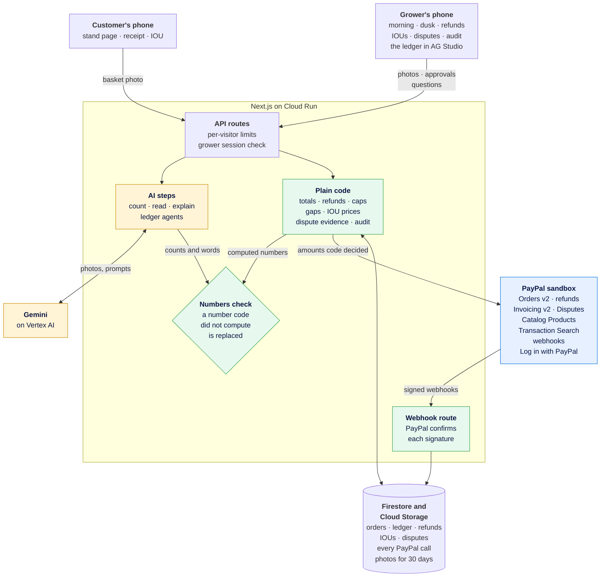

<p align="center">
  <picture>
    <source media="(prefers-color-scheme: dark)" srcset="assets/readme/strawbank-logo-reversed.png">
    
  </picture>
</p>

<p align="center"><i>minds the honesty box while the grower is in the field</i></p>

<p align="center">
  An AI shopkeeper for <b>unstaffed roadside farm stands</b>. The customer photographs their basket,<br>
  the AI <b>counts</b> it, plain code works out the total, and they pay with <b>PayPal</b>. At dusk it tells<br>
  the grower <b>what sold and what walked</b>, and it refunds small overcharges itself, within the grower's limit.
</p>

<p align="center">
  <b>PayPal AI Hackathon</b> &nbsp;·&nbsp; PayPal sandbox only &nbsp;·&nbsp; MIT
</p>

<p align="center">
  <a href="#how-a-day-works">How a day works</a>
  &nbsp;&nbsp;·&nbsp;&nbsp;
  <a href="#the-rule-the-ai-never-touches-money">The money rule</a>
  &nbsp;&nbsp;·&nbsp;&nbsp;
  <a href="#claims-and-where-to-check-them">Claims, and where to check them</a>
  &nbsp;&nbsp;·&nbsp;&nbsp;
  <a href="#what-this-is-not">What this is not</a>
</p>

<p align="center">
  
  
  
  
  
  
  
</p>

---

> **Status: in development.** Working in the PayPal sandbox today:
> - **The customer's side:** the stand page, the basket count and PayPal checkout. The receipt has "Something's wrong with this?", where the agent recounts the basket photo and refunds small, clear cases itself.
> - **No PayPal to hand?** The customer leaves an IOU: an email address, and PayPal sends them an invoice for the basket at the stand's prices. The grower can remind them, record cash, or cancel it.
> - **The grower's side:** sign-in, the morning set-up, the dusk report ("what sold and what walked"), the refunds queue, the IOUs, disputes (answered with the basket photo and the stand's own record), the next-morning audit against PayPal's Transaction Search, and the ledger in AG Studio, with an assistant that builds widgets from a question.
>
> This README only claims what works, and every result in it comes from `npm run eval`.
>
> **Try both sides in about ten minutes:** [strawbank-434001576954.europe-west1.run.app/try](https://strawbank-434001576954.europe-west1.run.app/try) walks you through opening the demo stand as its grower, buying from it on your phone, and closing the day. Or go straight to [the demo stand](https://strawbank-434001576954.europe-west1.run.app/s/demo).
> Payments are PayPal sandbox only; no real money moves.

---

## What is this, in plain terms?

All over Ireland, Britain and North America, farms sell eggs, jam, vegetables and flowers
from a table at the end of the lane, with nobody there. You take what you want and leave
the money in a jar or tin: an **honesty box**. It runs on trust, and three things go wrong:

- **The tin gets stolen**
  ([Laois](https://www.rte.ie/news/leinster/2023/0330/1367373-honesty-box-eggs), [Kildare](https://www.farmersjournal.ie/tillage/news/kildare-farmer-tracks-down-egg-and-potato-thieves-838832),
  [British Columbia](https://globalnews.ca/news/11323028/lake-country-b-c-farm-stand-operating-on-the-honour-system-raided)).
- **Fewer people carry cash**, so sales walk past.
- **At dusk the grower cannot tell what sold from what walked**, so they cannot tell
  whether the stand is worth keeping.

Strawbank keeps the trust and adds a shopkeeper. A QR code on the stand opens the shop on
the customer's phone, the AI counts the basket from a photo, and PayPal takes the payment.
At dusk, one more photo of the shelf, and the grower gets the day's truth in plain words.

---

## How a day works

| Moment | The AI | Plain code | PayPal (sandbox) |
|---|---|---|---|
| **Morning:** the grower photographs the price card and the shelf | reads the prices, counts the stock | nothing is for sale until the grower confirms | each new item becomes a catalogue product |
| **A customer:** scans the QR code, photographs the basket | counts the basket, with how sure it is | the customer has the final word; code works out the total | an order with one line per item, then the capture |
| **No PayPal to hand:** the customer leaves an IOU | | prices the basket exactly as an order would; the dusk report counts it as a payment on its way, never as walked | an invoice, sent by PayPal, paid later through PayPal or recorded as cash |
| **Something's wrong:** "I took one jar, not two" | recounts the stored photo | works out the refund, its cap, and who decides | the agent refunds small, clear cases within the grower's limit |
| **Dusk:** the grower photographs the shelf | counts what is left, then explains the day | taken minus paid, per item; an unsure count says "uncertain", never "missing" | our ledger, built from signed webhooks |
| **A customer disputes a payment** | | builds the evidence from the stand's own record, in code's words; holds the basket photo while the dispute is open | the dispute, the evidence with the photo, or the grower accepts the claim |
| **Next morning** | | compares our ledger with PayPal's records | Transaction Search |

---

## How it fits together



Yellow is the AI, green is plain code, blue is PayPal. The AI steps have no path to PayPal:
every amount PayPal sees was worked out by plain code. The customer approves each payment
in PayPal's own window, opened by the PayPal button on the stand page.

---

## PayPal, call by call

Every call that asks PayPal to do something, and each list the audit and the disputes page
read, is shown in the app as it happens, with PayPal's debug ID, on the grower's page and on
each receipt. "Seen working" is the date it last ran in the sandbox.

| What | PayPal endpoint | Through | Code | Seen working |
|---|---|---|---|---|
| Create the order, one line per item, collected at the stand (`PICKUP_IN_STORE`) | `POST /v2/checkout/orders` | PayPal Server SDK | `src/lib/paypal/orders.ts` | 28 Oct, 3 Nov (the pickup: 3 Nov) |
| Capture the payment | `POST /v2/checkout/orders/{id}/capture` | PayPal Server SDK | `src/lib/paypal/orders.ts` | 28 Oct, 3 Nov |
| Read the order for the receipt | `GET /v2/checkout/orders/{id}` | PayPal Server SDK | `src/lib/paypal/orders.ts` | 3 Nov |
| The PayPal button on the customer's phone | JS SDK v6 | `@paypal/paypal-js` | `src/components/stand/paypal-button.tsx` | 3 Nov |
| Partial refund, amount from code | `POST /v2/payments/captures/{id}/refund` | Agent Toolkit `create_refund` | `src/lib/paypal/refunds.ts` | 28 Oct, 3 Nov |
| Confirm a webhook's signature | `POST /v1/notifications/verify-webhook-signature` | REST | `src/lib/paypal/webhooks.ts` | 3 Nov (a real refund event confirmed; a forged one refused) |
| List the day's items as products | `POST /v1/catalogs/products` | Agent Toolkit `create_product` | `src/lib/paypal/catalog.ts` | 3 Nov |
| The next-morning audit | `GET /v1/reporting/transactions` | PayPal Server SDK | `src/lib/paypal/transactions.ts` | 3 Nov |
| Write an IOU as an invoice, one line per item | `POST /v2/invoicing/invoices` | REST, with the SDK's token | `src/lib/paypal/invoices.ts` | 3 Nov |
| Send it: PayPal emails the customer a pay link | `POST /v2/invoicing/invoices/{id}/send` | REST | `src/lib/paypal/invoices.ts` | 3 Nov |
| Remind the customer | `POST /v2/invoicing/invoices/{id}/remind` | REST | `src/lib/paypal/invoices.ts` | 3 Nov |
| Record cash paid at the stand | `POST /v2/invoicing/invoices/{id}/payments` | REST | `src/lib/paypal/invoices.ts` | 3 Nov |
| Read an IOU's status for the customer | `GET /v2/invoicing/invoices/{id}` | REST | `src/lib/paypal/invoices.ts` | 3 Nov |
| Cancel an IOU | `POST /v2/invoicing/invoices/{id}/cancel` | REST | `src/lib/paypal/invoices.ts` | not yet |
| List and show disputes at the stand | `GET /v1/customer/disputes`, `GET /v1/customer/disputes/{id}` | REST | `src/lib/paypal/disputes.ts` | 3 Nov (listed; no dispute yet) |
| Send the evidence: code's notes and the basket photo | `POST /v1/customer/disputes/{id}/provide-evidence` | REST, multipart | `src/lib/paypal/disputes.ts` | not yet: needs a sandbox dispute |
| Refund instead | `POST /v1/customer/disputes/{id}/accept-claim` | REST | `src/lib/paypal/disputes.ts` | not yet |
| Grower sign-in | `/connect`, `POST /v1/oauth2/token`, `GET /v1/identity/oauth2/userinfo` | REST | `src/lib/paypal/login.ts` | not yet: waits for the app's Log in with PayPal setting |

Webhook events received: payment captured, denied, declined, refunded and reversed; order
approved and completed; invoice paid and cancelled; dispute created, updated and resolved
(the last two kinds added 3 Nov, none received yet). Each one
is applied to the ledger once, whatever order it arrives in (eval E4.4).

---

## The rule: the AI never touches money

The AI reads, counts and explains. **Every total, refund, cap and gap is plain code**,
because if the same input must always give the same answer, a guess is not good enough.
Even the AI's dusk explanation is checked: any number in it that code did not compute, and
the AI's words are replaced by a plain template. The ledger's assistant gets the same check:
any number in its words that the ledger's own tools did not return, and code's line replaces it.

That rule is tested before anything else is built. `npm run eval` runs eval **E4**: 25
properties, each tried against generated cases (fast-check), on **22,050 cases with 0
failures** (scorecard `eval/results/2026-11-03.json`).

| Id | The property |
|---|---|
| E4.1 | Order total = sum of lines (quantity x price) = PayPal `item_total`, in minor units |
| E4.1b | A basket with an unknown item or a bad quantity never becomes an order |
| E4.1c | The PayPal SDK request carries the order body's amounts and lines unchanged |
| E4.2 | A refund never exceeds what was paid minus earlier refunds; the agent acts only within its limit, on a confident recount that backs the claim |
| E4.2b | Under repeated, concurrent and failing requests, refunds never exceed what was captured |
| E4.2c | A refund sent to PayPal is exactly the amount code decided; a refusal frees it, and no answer keeps it pending |
| E4.3 | The same refund request never produces two refunds |
| E4.4 | A duplicate or late webhook never changes the ledger twice |
| E4.4b | Only a webhook PayPal confirms as signed reaches the ledger, and only once |
| E4.5 | The AI's text never introduces a number that is not in the computed reconciliation |
| E4.5b | Text that uses only computed numbers passes the check |
| E4.5c | Whatever the AI writes, the text shown contains only computed numbers |
| E4.5d | No note the AI writes about a basket reaches the customer if it mentions money |
| E4.5e | A plain counting note, with no money in it, is shown as written |
| E4.6 | The PayPal Agent Toolkit, as configured, offers the agent exactly its allowed tools |
| E4.6b | The agent never calls a tool outside its allowlist |
| E4.6c | No tool handed to the model can move money; refunds run only from code |
| E4.7 | A grower session opens only if the server sealed it, unaltered and in date (the grower's pages hold refund approvals) |
| E4.8 | The ledger's AI assistant shows only numbers the ledger's own tools returned or the grower wrote |
| E4.9 | Each Gemini turn's tool calls reach Gemini before their results, signed as received, none lost |
| E4.10 | An IOU invoice asks for exactly what an order for the same basket would, to the address given |
| E4.11 | An IOU counts as paid only when PayPal says it was paid or the grower recorded cash |
| E4.12 | Every order tells PayPal the goods were collected at the stand, at the stand's own address |
| E4.13 | Dispute evidence states the stand's own record exactly: the amount captured, each line, any refund, and only what really happened |
| E4.13b | Dispute evidence never claims a type that needs a tracking number or refund id |

The tests were checked by planting bugs in the money code (a total off by a cent, a refund
limit off by a cent, a missing duplicate check, a ledger that counts a repeat twice); each
planted bug made a property fail. On 3 Nov the same was done for E4.8 to E4.13 (an invoice price one cent high, a part-paid IOU counted as paid, the assistant's number check removed, a Gemini turn's calls split or unsigned, an order sent as "shipping", dispute notes with the captured amount a cent high or a pickup claimed that PayPal was not told); each was caught.

Basket counting (eval **E1**) runs on real photos of eggs, onions and potatoes, loose,
in an egg box, in a bag and in a hand. On the first **10 baskets, the latest run counted 9
exactly** (one run earlier that day counted all 10), and no basket was off by more than one
item. The grower's side is measured the same way:

- **E2, the price card:** read exactly, 3 of 3 lines.
- **E3, shelf counts:** in the latest run, both shelf photos were counted exactly (8 of 8 item counts). Two runs earlier the same day had one photo time out after 75 seconds, because a Gemini call stalled; a second try now starts at 12 seconds and a third at 30. A grower whose count still times out can count by hand.

All three are provisional until every photo is in.

Two evals check whole days with no model at all:

- **E5, the dusk report:** twenty simulated days built from what each customer really did. They include a walker, an underpayment, a restock, a refund, a payment PayPal has not confirmed yet and an unsure count. **20 of 20 days are exactly right, with 0 wrong accusations.** A payment PayPal has not confirmed makes its item "uncertain", never "missing".
- **E7, the next-morning audit:** seven days with planted differences between our ledger and PayPal's Transaction Search, among other stands' and days' transactions. **7 of 7 flagged exactly the planted differences**, and nothing else.

Agent safety (E6) waits for its last trap photos. Every eval is described in
[docs/eval.md](docs/eval.md) (scorecard `eval/results/2026-11-03.json`).

---

## Claims, and where to check them

Each claim this README or the app makes, with the code behind it and the eval that tests it.
CI runs the money, day and audit evals (E4, E5, E7) on every push; the photo evals need
Gemini credentials, so their numbers come from the scorecard.

| Claim | Where to check it |
|---|---|
| The AI never decides an amount of money, and no tool handed to the model can move money | `src/agent/tools.ts`, `src/lib/paypal/refunds.ts`; E4.6 to E4.6c |
| The customer pays exactly the sum of their lines at the stand's prices, and that is exactly what PayPal is asked for | `src/lib/orders.ts`; E4.1 to E4.1c. The receipt shows the order as PayPal reports it |
| The agent refunds by itself only within the grower's limit, and only when its recount of the photo backs the claim; anything else waits for the grower | `src/lib/refunds.ts`, `src/lib/refund-flow.ts`; E4.2. On a receipt, press "Something's wrong with this?" |
| Refunds never add up to more than was paid, and one request never refunds twice | `src/lib/refund-store.ts`; E4.2b, E4.2c, E4.3 |
| Only webhooks PayPal confirms as signed reach the ledger, and each changes it once | `src/app/api/webhooks/paypal/route.ts`, `src/lib/ledger.ts`; E4.4, E4.4b. Each confirmation is listed under "What Strawbank asked PayPal" on the grower's page |
| Any number in the AI's words that code did not compute is replaced, at dusk and in the ledger's assistant | `src/lib/explain-check.ts`, `src/lib/ai/studio-turn.ts`; E4.5 to E4.5e, E4.8 |
| The dusk report says "uncertain", never "missing", when a count or a payment is not sure: 20 of 20 simulated days exactly right, nobody wrongly accused | `src/lib/reconcile.ts`, `src/lib/dusk.ts`; E5 |
| On the first 10 real basket photos, the latest run counted 9 exactly, and none was off by more than one item | `eval/e1-baskets.ts`, the photos in `eval/photos/baskets/`, the right answers in `eval/truth/baskets/`; E1 in the scorecard |
| The next-morning audit flags exactly the differences between our ledger and PayPal's Transaction Search: 7 of 7 | `src/lib/audit.ts`; E7. The grower's "Next-morning audit" page |
| An IOU is invoiced at exactly what an order for the same basket would charge, and counts as paid only when PayPal says so or the grower records cash | `src/lib/ious.ts`, `src/lib/iou-flow.ts`; E4.10, E4.11 |
| Every order tells PayPal the goods were collected at the stand | `src/lib/orders.ts`; E4.12. "Collected at the stand" on the receipt is read back from PayPal's order |
| Dispute evidence says only what the stand's record shows, in code's words | `src/lib/dispute-evidence.ts`, `src/lib/dispute-flow.ts`; E4.13, E4.13b |
| Every call that asks PayPal to do something is shown with PayPal's debug ID | `src/lib/paypal/calls.ts`. "What Strawbank asked PayPal" on each receipt and on the grower's page |
| A grower's pages open only with a session the server sealed, and act only on that grower's stand | `src/lib/session.ts`, `src/lib/grower-guard.ts`; E4.7 |
| Sandbox only: no setting points the app at live PayPal | `src/lib/paypal/config.ts`, `src/lib/paypal/client.ts` |

How each risk is handled, and what is not done yet: [SECURITY.md](SECURITY.md). Why it is built
this way: [docs/decisions.md](docs/decisions.md).

---

## Built with

The stack, as each part lands:

- **PayPal, sandbox only:** Orders v2 with itemised lines and capture, Payments v2 refunds,
  Invoicing v2 for the IOU, the Disputes API, Catalog Products, Transaction Search, signed webhooks, the PayPal JS SDK, the PayPal Agent
  Toolkit for the agent's tools, and the PayPal Server SDK, written with the **APIMatic
  Context Plugin**.
- **Gemini** on Google Vertex AI, through the Vercel AI SDK: reading, counting, explaining.
- **AG Studio** by AG Grid: the grower's ledger. Four pre-built pages, the stand's own theme,
  a custom "paid versus taken" widget that filters the page by item, and Strawbank's own agent,
  which hands the building to Studio's planning, page, widget and data agents. Every agent runs
  on Gemini through our own adapter (`src/components/ledger/gemini-adapter.ts`).
- **Next.js 16** (TypeScript), hosted on Google Cloud Run.

---

## Run it yourself

Needs Node.js 20.9 or later.

```bash
npm install
npm run eval       # the evals; writes eval/results/<date>.json
npm run dev        # the app shell, on http://localhost:3000
```

For the PayPal and Gemini parts, copy `.env.example` to `.env.local` and fill in sandbox
credentials. The hosted demo needs none of this: it is live at
https://strawbank-434001576954.europe-west1.run.app, and the demo stand is
[`/s/demo`](https://strawbank-434001576954.europe-west1.run.app/s/demo). A sandbox buyer
login for judges: to come.

---

## Code layout

| Path | What |
|---|---|
| `src/lib/money.ts` | money as whole minor units; decimal strings only at the edges |
| `src/lib/orders.ts` | counts x confirmed prices, order lines, the Orders v2 body |
| `src/lib/paypal/` | the PayPal Server SDK client (sandbox only); order create, capture and get; Transaction Search; the refund gateway and catalogue products (Agent Toolkit); Log in with PayPal |
| `src/lib/refunds.ts` | refund amount, cap and who decides; at most one refund per request |
| `src/lib/ledger.ts` | the webhook ledger; repeated or late webhooks change nothing |
| `src/lib/webhook.ts`, `src/lib/paypal/webhooks.ts` | the webhook route: PayPal confirms each signature (`verify-webhook-signature`) before anything is stored |
| `src/lib/ledger-store.ts` | the ledger in Firestore: one transaction per event, keyed by its id |
| `src/lib/reconcile.ts`, `src/lib/dusk.ts` | taken, paid and gap per item at dusk, from the day's orders and PayPal's word on each |
| `src/lib/refund-flow.ts`, `src/lib/refund-store.ts` | a customer's claim, the agent's recount, code's decision, one Firestore transaction per refund |
| `src/lib/audit.ts` | the next-morning audit: the ledger against PayPal's Transaction Search |
| `src/lib/ious.ts`, `src/lib/iou-flow.ts`, `src/lib/paypal/invoices.ts` | the IOU: the invoice body (same prices as an order), PayPal Invoicing, and PayPal's word on each |
| `src/lib/dispute-evidence.ts`, `src/lib/dispute-flow.ts`, `src/lib/paypal/disputes.ts` | disputes: the evidence pack from the stand's record, PayPal's Disputes API, and the photo hold |
| `src/lib/ledger-rows.ts`, `src/components/ledger/` | the ledger in AG Studio: rows built by code, the report, the custom widget, the agent and its Gemini adapter |
| `src/lib/ai/studio-turn.ts` | one turn of the ledger's agents on Gemini; any number in their words must be one the ledger's tools returned |
| `src/lib/sales.ts`, `src/lib/photos.ts` | each order and basket count, and the photo kept as evidence for 30 days |
| `src/lib/explain-check.ts` | rejects AI text with a number code did not compute |
| `src/agent/tools.ts` | the agent's PayPal tool allowlist |
| `src/agent/toolkit.ts` | the PayPal Agent Toolkit, sandbox only, adapted to AI SDK v7; money tools never reach the model |
| `src/app/` | the stand page and receipt, the grower's pages, the ledger, the API routes |
| `eval/` | the eval; see [docs/eval.md](docs/eval.md) |
| `docs/decisions.md`, `SECURITY.md` | why it is built this way, and how each risk is handled |

---

## What this is not

- **Not theft prevention.** It measures what walked; it does not stop it.
- **Not surveillance.** The camera points at the shelf and the basket, never at people,
  and nobody is identified.
- **Not a point-of-sale terminal.** Customers pay on their own phones.
- **Never the decider of a price or an amount of money.** The grower sets prices; code does
  the sums.

---

## Licence

MIT. See [LICENSE](LICENSE).
